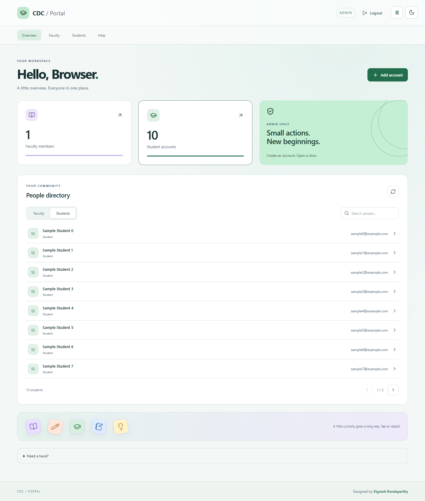
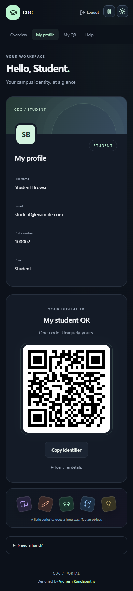

# CDC Portal — MERN Authentication & Role-Based Dashboard

Full-stack implementation of the CDC Developer Selection mini assignment. React/Vite + Tailwind, Express, MongoDB/Mongoose, bcrypt, JWT (HttpOnly cookie), and student QR identifiers.

## Project Development Flow

Use the following sequence to understand, extend, and verify the project. These stages describe the development workflow. Completed automated checks and remaining environment steps are recorded in [VERIFICATION.md](VERIFICATION.md).

### 1. Define requirements and role permissions

- **Admin:** sign in, create Faculty and Student accounts, and list accounts by role.
- **Faculty:** sign in and view their own profile.
- **Student:** sign in, view their own profile and roll number, and display their unique QR identifier.
- Keep account creation restricted to Admin. Public signup and the features listed under Known limitations are outside the current scope.

### 2. Prepare the project and environment

- `server/` contains the Express API, MongoDB model, authentication middleware, and Admin seed script.
- `client/` contains the React interface, role-based routes, and Vite configuration.
- Follow **Setup (Windows PowerShell)** below to install dependencies in both folders, configure `server/.env`, connect MongoDB, and seed the first Admin.
- Keep credentials on the server and out of version control. Start the backend and frontend in separate terminals.

### 3. Implement persistence and authentication

1. Define the User model in `server/src/models/User.js`, including role values, unique email, and student-only identifiers.
2. Configure MongoDB connectivity in `server/src/config/db.js` and server startup in `server/src/server.js`.
3. Use `server/src/scripts/seedAdmin.js` to create the initial Admin without resetting an existing account.
4. Implement login, logout, and session lookup in `server/src/routes/auth.js`. Hash passwords with bcrypt and issue the JWT through an HttpOnly cookie.
5. Enforce authentication and Admin authorization in `server/src/middleware/auth.js`. Backend checks must protect data even when a caller bypasses the frontend.

### 4. Build account-management and profile APIs

- In `server/src/routes/admin.js`, validate account input, hash initial passwords, normalize email addresses and student roll numbers, and generate a UUID for each Student.
- Return validation errors for invalid input and conflict errors for duplicate unique fields.
- Expose the authenticated user's profile through `/api/profile/me`, using identity resolved by authentication middleware.
- Configure API routing, cookie parsing, CORS, request limits, login rate limiting, and error handling in `server/src/app.js`.

### 5. Connect the React dashboards

- In `client/src/App.jsx`, restore the session using `/api/auth/me`, submit login requests, and clear local session state on logout.
- Route authenticated users to `/admin`, `/faculty`, or `/student` according to their role.
- Connect Admin forms and lists to the Faculty and Student endpoints; refresh lists after account creation.
- Display the signed-in user's profile and render the Student UUID as a QR code. The QR value is an identifier, not a login credential.
- Include loading, success, and error feedback. Use `/api` requests with cookies through the local Vite proxy.

### 6. Verify the integrated application

Run the application against a development database and complete this checklist:

- [ ] `GET /api/health` returns `200` with `{"status":"ok"}`.
- [ ] The seeded Admin can sign in and reaches the Admin dashboard.
- [ ] Admin can create Faculty and Student accounts and see them in the correct lists.
- [ ] Each created account can sign in and sees its own role-appropriate profile.
- [ ] Student QR content matches that student's UUID and remains stable after signing out and back in.
- [ ] Reloading a dashboard restores a valid session; signing out prevents subsequent authenticated API access.
- [ ] Protected API requests without a valid session return `401`; Faculty and Student requests to Admin endpoints return `403`.
- [ ] Duplicate email and student roll number submissions return `409`; invalid account input returns `400`.
- [ ] Incorrect login credentials are rejected, and API responses omit password hashes.
- [ ] Direct navigation to another role's dashboard redirects to the signed-in user's dashboard.
- [ ] Login, forms, account lists, and QR display remain usable on narrow and wide screens.
- [ ] From `client/`, `npm run build` completes successfully.

Run `npm test` from `server/` for isolated MongoDB integration tests and `npm run test:ui` for browser verification after installing dependencies in both packages. Browser setup, verified results, and remaining checks are documented in [VERIFICATION.md](VERIFICATION.md). A successful frontend build alone does not verify API behavior or MongoDB integration.

### 7. Prepare delivery and deployment

1. Complete the **Demo walkthrough** below using development accounts.
2. Review the production environment variables, HTTPS configuration, cookie behavior, and same-origin `/api` routing described in **Security** and **Deployment note**.
3. Build the frontend from `client/` with `npm run build`; serve its generated `dist/` assets through the chosen web host.
4. Run the backend from `server/` with `npm start` and provide its environment variables through the hosting environment.
5. Repeat the authentication, authorization, account-creation, and QR checks on the deployed application before handover.
6. Keep the README's setup steps, API table, limitations, and verification results aligned with future changes.

## Prerequisites
- Node.js 20.19+ (or Node.js 22+)
- MongoDB running locally **or** a MongoDB Atlas connection URI
- npm

## Setup (Windows PowerShell)
1. `cd server`
2. `npm install`
3. Copy `.env.example` to `.env` (`Copy-Item .env.example .env`)
4. Edit `.env`: set `MONGO_URI`, a long random `JWT_SECRET` (32+ characters), and strong `ADMIN_PASSWORD`.
5. `npm run seed` (creates Admin once; never resets an existing account)
6. `npm run dev` (backend: http://localhost:5000)
7. Open another terminal: `cd client` (from project root), `npm install`, `npm run dev`.
8. Open http://localhost:5173 and log in with `ADMIN_EMAIL` and `ADMIN_PASSWORD` from your private `.env`.

### MongoDB Atlas
Create a cluster, database user, and network access rule; copy the connection URI into `MONGO_URI` in **server/.env**. Replace URI username/password placeholders and URL-encode special characters. Do not put the URI in the React frontend or commit it.

## Environment variables
| Variable | Purpose |
|---|---|
| MONGO_URI | MongoDB connection string |
| JWT_SECRET | JWT signing secret, 32+ characters |
| PORT | Express port (default 5000) |
| CLIENT_ORIGIN | Allowed frontend origin (default http://localhost:5173) |
| NODE_ENV | `development` locally, `production` behind HTTPS |
| ADMIN_NAME | Name for seeded Admin |
| ADMIN_EMAIL | Email for seeded Admin |
| ADMIN_PASSWORD | Password for seeded Admin (never commit) |

## API
| Method | Route | Access |
|---|---|---|
| POST | /api/auth/login | Public |
| POST | /api/auth/logout | Public (clears cookie) |
| GET | /api/auth/me | Authenticated |
| POST | /api/admin/faculty | Admin |
| GET | /api/admin/faculty | Admin |
| POST | /api/admin/students | Admin |
| GET | /api/admin/students | Admin |
| GET | /api/profile/me | Authenticated |
| GET | /api/health | Public |

### Login example
`POST /api/auth/login` with JSON `{"email":"admin@example.com","password":"<your private password>"}`. A successful response sets an HttpOnly JWT cookie. Frontend requests use `credentials: 'include'`.

## MongoDB User schema
`name`, `email` (unique), `passwordHash` (hidden by default), `role` (`admin|faculty|student`), `rollNumber` (student only, unique partial index), `studentQrId` (student only, UUID, unique partial index), timestamps. Passwords are bcrypt-hashed; hashes are never serialized.

## Security
Backend authorization checks both verified JWT and MongoDB user role. `/api/profile/me` derives identity from the cookie, never user-supplied IDs. Login rate-limited. No public signup or Admin registration. Password hashes omitted from responses. Cookie is HttpOnly, SameSite=Lax, and Secure in production. For a production deployment, use HTTPS, appropriate trusted reverse-proxy configuration, and consider additional CSRF defenses for cross-site deployment scenarios. This project is configured for same-origin local development through the Vite proxy.

## Demo walkthrough
1. Seed Admin and sign in.
2. Create Faculty and Student in Admin tabs.
3. Sign out, sign in as Faculty, show self-profile.
4. Sign out, sign in as Student, show QR.
5. In browser dev tools, request `/api/admin/students` while signed in as Student: response `403`.
6. Try duplicate email and duplicate student roll number: response `409`.

## AI assistance
This project was generated with assistance from ChatGPT. Review, run, test, and explain the code before submission.

## Known limitations
This mini assignment intentionally excludes public forgot-password recovery, attendance, course management, email delivery, and refresh-token rotation. Student QR stores a UUID only, not an authentication token.

## Deployment note
Vite's `/api` proxy works only during local development. For deployment, configure a same-origin reverse proxy routing `/api` to Express, or adapt the frontend API base URL and cookie/CORS/CSRF settings accordingly. Never use GitHub Pages alone to host this backend.

## Dashboard experience
Admin has live account totals, searchable alphabetical lists, eight accounts per page, expandable details, and a modal creation form. Faculty and students see only their own required profile fields; students also see their QR code and can copy its identifier. Animations respect reduced-motion preferences. The dashboard refresh preserves existing credentials and account records.

### Dashboard previews
These screenshots use isolated test accounts, not the existing local accounts.

## Updated account format and navigation
Student roll numbers are unique six-digit strings (for example, 100001), validated by the API, model, and creation form. Login includes an accessible Show/Hide password eye button. Dashboards provide role-specific section navigation and help, with motion disabled when reduced motion is preferred. Private local faculty/student credential lists were regenerated after the requested password changes; do not commit the .local directory.

## Appearance controls
Use the sun/moon button at the top-right of any page to switch between light and dark themes. The choice is saved on this browser. Campus objects drift across the screen on randomized paths; reduced-motion preferences are respected. Books, pens, notebooks, caps, and light bulbs respond to pointer or keyboard activation on login and dashboard pages. Layouts expand across desktop screens and adapt to mobile. Every page carries the Designed by Vignesh Kondaparthy credit. Account credentials are unchanged by these interface updates.

## Account management and self-service

Faculty and students can open **Settings** to change their email or password after confirming their current password. Old sessions become invalid; the current self-service session remains signed in. Admin can expand a person in the directory to **Edit profile** (name/email) or **Reset password** with confirmation. Account IDs, roll numbers, and QR identifiers are preserved.

Admin **Activity** and account lists refresh automatically every 15 seconds while the page is visible. Activity shows who changed email/password and when. Passwords remain one-way bcrypt hashes: Admin can set a new password, but cannot retrieve an existing password. Generated/reset passwords are visible only in the form where they are entered; share them privately. The old `.local` login lists are initial snapshots and become outdated after changes.

Students can **Download QR** as a PNG containing their name and six-digit roll number. The QR itself still contains only the non-sensitive student UUID. Account creation suggests an available roll number and can generate an initial password. A suggestion is not a reservation; duplicate creation is rejected by MongoDB.

| Method | Endpoint | Access |
|---|---|---|
| PATCH | /api/profile/email | Faculty/Student; current password required |
| PATCH | /api/profile/password | Faculty/Student; current password required |
| GET | /api/admin/next-roll | Admin |
| GET | /api/admin/activity | Admin |
| PATCH | /api/admin/accounts/:id | Admin; Faculty/Student targets only |
| POST | /api/admin/accounts/:id/reset-password | Admin; password and confirm:true required |

All new/reset passwords must be 8–72 UTF-8 bytes. Email ownership is not verified by email delivery in this local assignment. There is no public forgot-password recovery. See [the review/demo guide](docs/DEMO.md) for a timed walkthrough and explanations of authentication, permissions, session invalidation, and QR generation.

